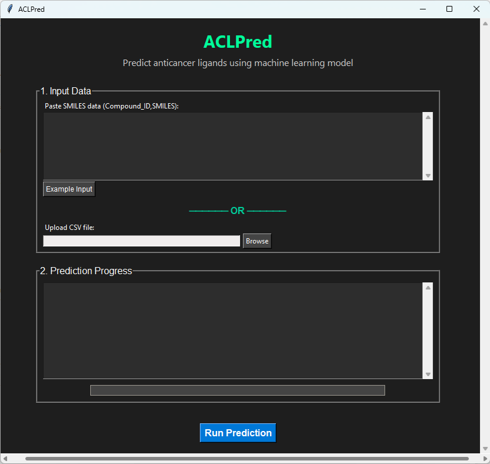

# ACLPred: Anticancer ligand prediction using a machine learning model
**ACLPred** is a GUI-based tool designed for the prediction of Anticancer compounds from a large pool of chemical compounds. This method uses Light Gradient Boosting Machine (LGBM), a tree-based ensemble algorithm, to make the predictions. ACLPred allows users to screen potential anticancer compounds with high efficiency and accuracy. The overview of the developed model is shown in the following figure:  


The ACLPred used a pre-trained machine learning model based on the molecular properties of the chemical compounds. Various machine learning algorithms were explored during development, and a high-performing LGBM model was ultimately implemented in ACLPred. We evaluated the model performance using independent test data, external validation datasets, as well as existing methods to confirm its effectiveness and generalizability to predict anticancer compounds. Additionally, model interpretation analysis was conducted to identify key features that significantly contribute to anticancer activity prediction. 

# Getting Started

## Prerequisites

Before using ACLPred, ensure the required software and modules are installed:

* OS support: Windows, Linux
* Python version: 3.12.7

### Dependencies
- sklearn
- pandas
- numpy
- rdkit
- padelpy

## How to use

1. Clone or download this repository:
```sh
  git clone https://github.com/ArvindYadav7/ACLPred
  cd ACLPred
```
2. Install dependencies:
```sh
   $ pip install -r requirements.txt
```
3. Run the Python script to launch the ACLPred:
  - For Terminal:
    ```sh
      python aclpred_gui.py
    ```
  - For Jupyter notebook:
    
      Upload `aclpred_gui.ipynb` in your Jupyter notebook and `Run`
    
## Graphical User Interface (GUI)
ACLPred features a user-friendly graphical interface built using Tkinter, the standard Python interface to the Tk GUI toolkit.



### Input Format

You can provide input in two ways:

1. Paste Input (Text Box):
   Format should be `Compound_ID, SMILES` (See example input)

2. Upload CSV File:
   Your file should have two columns: `Compound_ID` and `SMILES` (See example file `/dataset/example_file.csv`)

## Output

The predictions are saved in `Output_result.csv` in the working directory and include:

  - `Compound_ID`
  - `Prediction` (`Anticancer` / `Non-anticancer`)
  - `Prediction_Probability` (confidence score)

## License

The ACLPred is licensed under the MIT License. See the [LICENSE](LICENSE) file for more details.


## Citation

***If you use ACLPred in your research, please cite:*** Yadav, A.K., Kim, JM. ACLPred: an explainable machine learning and tree-based ensemble model for anticancer ligand prediction. Sci Rep 15, 31268 (2025). https://doi.org/10.1038/s41598-025-16575-4

## Contact

For any query, please contact [yadavarvind@cau.ac.kr], [junmokim@cau.ac.kr].
